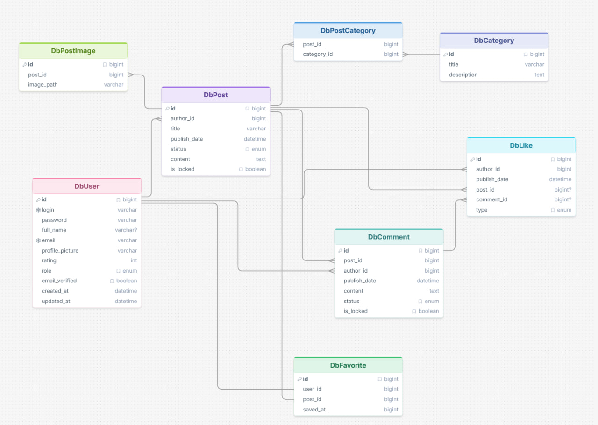

# USOF Backend

Q&A API built with Node.js, Express, MySQL and AdminJS.

## Setup

Requires Node.js 22.12+, MySQL and SMTP. Run from `API/`:

1. Copy `.env.example` to `.env` and configure database, SMTP and secrets.
2. Set `PORT=8888`, `APP_URL=http://localhost:8888`, `FRONTEND_URL=http://localhost:5173`.
3. Run:

```bash
npm install
npm run db:setup
npm start
```

Startup applies pending migrations. Seeds can be rerun without duplicates. MySQL credentials need permission to create the database. Stop the existing backend before starting another on the same port.

## Features

- Registration, email verification, JWT login and password reset.
- Posts with images, categories, comments, reactions and automatic rating.
- Search, sorting, filters and pagination.
- Favorites and email subscriptions.
- Admin user/category management and invitations.

## Invitations

An admin sends email and role through `POST /api/users/invitations`. The recipient submits login and password to `POST /api/auth/accept-invitation`. Acceptance creates a verified account and returns an access token.

Links expire after 24 hours. Only token hashes are stored. Acceptance deletes invitations for that email; delivery failure removes the new invitation. Expired records are not automatically deleted.

## Access

Protected requests use `Authorization: Bearer <token>`. Login requires a verified email. Only the author or an admin can change comment status, lock or delete it. Comment text cannot be edited.

Post images can be uploaded only by the author. Locked posts/comments reject new replies and reactions from regular users. Logout removes the client token; it does not revoke the JWT. Password reset links remain reusable until expiry.

## Reference

- Admin panel: `/admin`, verified admin account required.
- API reference: `/api/docs` (Scalar requires internet).
- OpenAPI: `/api/openapi.json`.
- [Implementation notes](docs/basic.md)



The diagram covers the original schema; later migrations add favorites, subscriptions and invitations.
