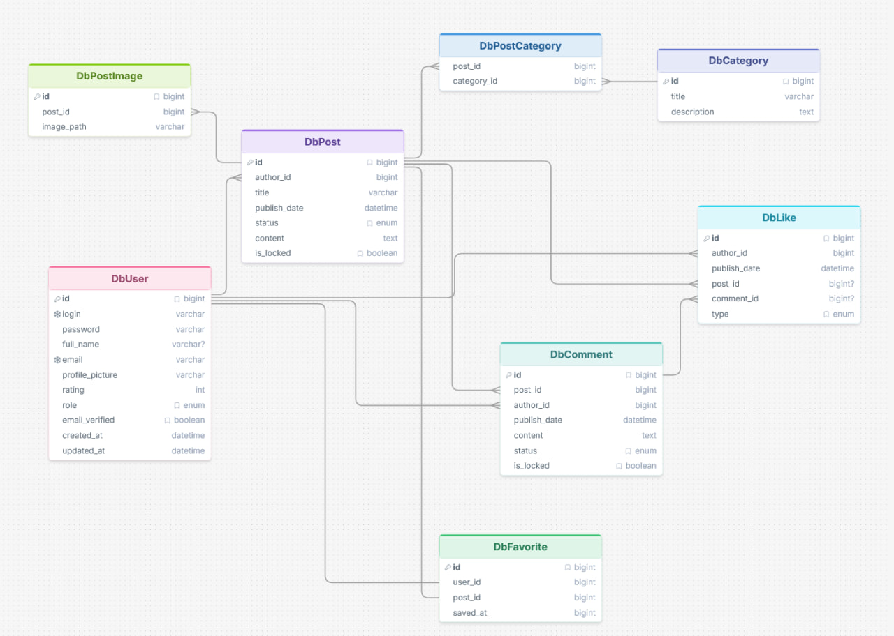
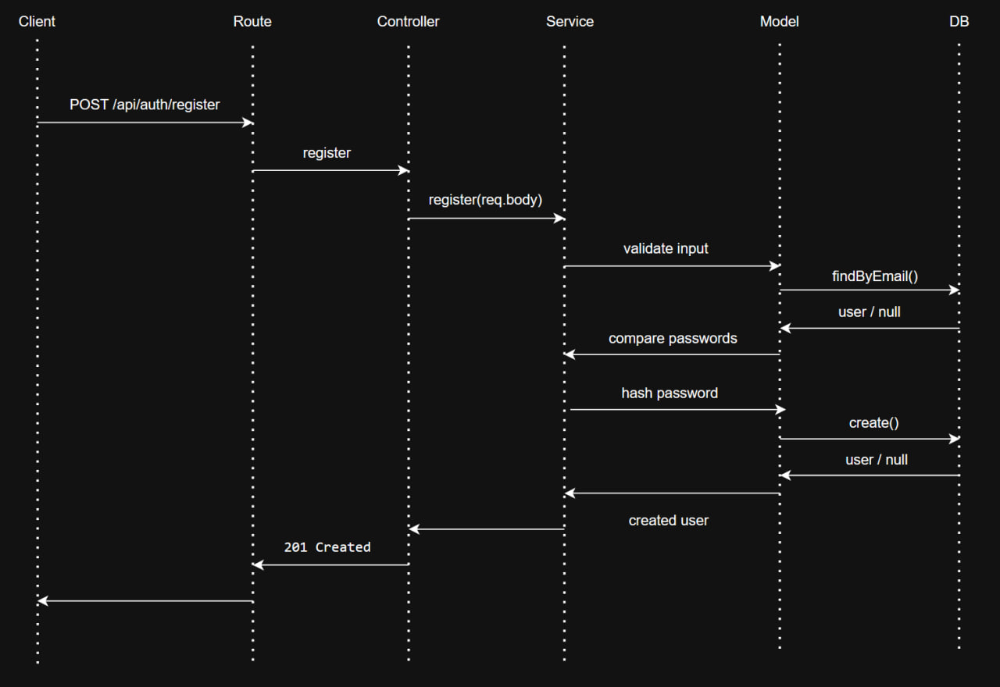

# Act: Basic

## Overview

The application will follow the MVC architectural pattern and will provide functionality for authentication, users, posts, categories, comments, likes and dislikes, as well as an admin panel.

## Application Setup

The initial Node.js and Express application was created.

The project uses ESM and environment variables for application configuration.

The initial project structure was prepared to separate different application responsibilities.

Environment variables are stored in a `.env` file, while `.env.example` provides an example of the required configuration.

At this stage, the application can be started successfully and responds to a basic HTTP request.

## Database Design

I designed the database structure using MySQL.

The main entities are DbUser, DbPost, DbCategory, DbComment, DbLike, and DbPostImage. A many-to-many relationship between posts and categories is implemented using the DbPostCategory table.

A Diagram was created to define the relationships between all entities before implementing the database.

The database schema is managed using migration files. A custom migration runner executes migrations in order and stores completed migrations in a migrations table, preventing them from being executed again.

Seed scripts were also created to populate the database with initial development data. The scripts can be executed multiple times without creating duplicate seed records.

## Models + Authentication and authorization

The User model was created to work with user data in the database. It can find users by id, login, or email, return all users, create a new user, verify an email, and update a password. Public user queries return only the fields that can be shown in an API response and do not expose the password hash.

The authentication module supports registration, email verification, login, logout, and password reset. User passwords are hashed with bcrypt before they are saved. JWT tokens are used for email verification, password reset, and access to protected routes. The authentication middleware checks the access token and adds the user id and role to the request. The application has user and admin roles, and the role from the token will be used to control access to actions that are available only to administrators.

## Users

Users can view profiles and change their own login, full name, email, and avatar. When an email changes, the new address must be verified. Only an admin can create users through the user API, change their roles, or delete them. A new user has the `user` role by default. To create another admin, an admin first creates a user and then changes that user's role. If a user is deleted, their posts stay in the database and the author is shown as `removed`.

## Posts

The post list is public and shows active posts. Authors can also view their own inactive posts, and admins can view all posts. The list uses pagination and can be sorted by the number of likes or by date. It can be filtered by category, date interval, and status. A post must have a title, content, and at least one category. One post can belong to several categories.

The author can update or delete a post. Post images can be uploaded as local files by the author or an admin. The upload accepts JPEG, PNG, WebP, and GIF files, with a limit of five images and 5 MB per image in one request. A post can be locked to stop regular users from adding comments or likes. Admins can set a post to active or inactive.

## Categories, comments, and likes

Categories and their posts can be viewed through the API. Only admins can create, update, or delete categories. Authenticated users can add comments under active posts that are not locked. Comments can also be locked, which stops new reactions from regular users. A user can add one like or dislike to a post or comment and can remove their own reaction. The database prevents duplicate reactions to the same item.

User rating is calculated from the likes and dislikes received on that user's posts and comments. Each like adds one point and each dislike removes one point. The value is updated when reactions or related content change.

## Admin panel and request flow

AdminJS is available at `/admin` and has a separate login session. Only verified users with the `admin` role can enter. The panel shows users, posts, categories, comments, and likes. Admins can create and delete records. When editing an existing post or comment in the panel, they can change only its status. The text, categories, and lock state are not changed there.

Express sends a request to a route and then to a controller. Middleware checks the access token and role when needed. The controller calls a service for validation and business rules, and the service uses a model to read or change MySQL data. The controller returns JSON or an error message. AdminJS actions also use these services. API logout does not invalidate a JWT on the server; the client removes its token.

## Validation and errors

The application checks IDs, login names, email addresses, passwords, post data, and uploaded images. It returns errors for invalid input, missing records, duplicate values, and actions without the required permission. Uploaded files are checked before they are saved. Internal errors do not return database details to the client.
